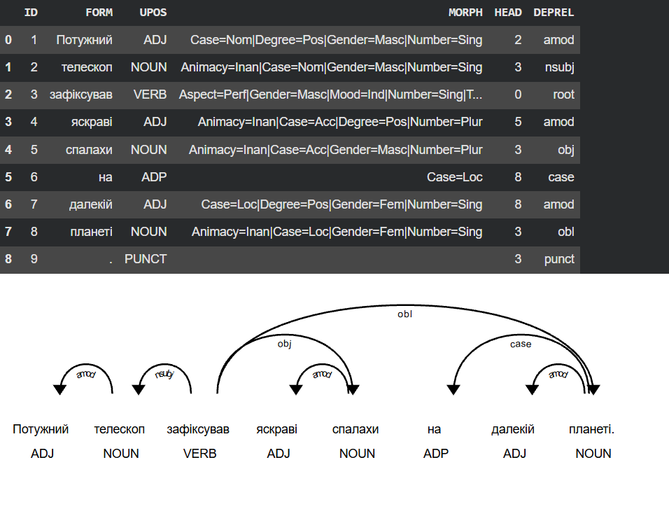
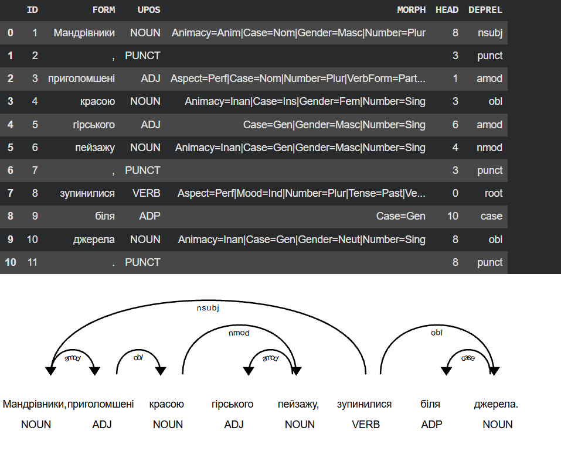
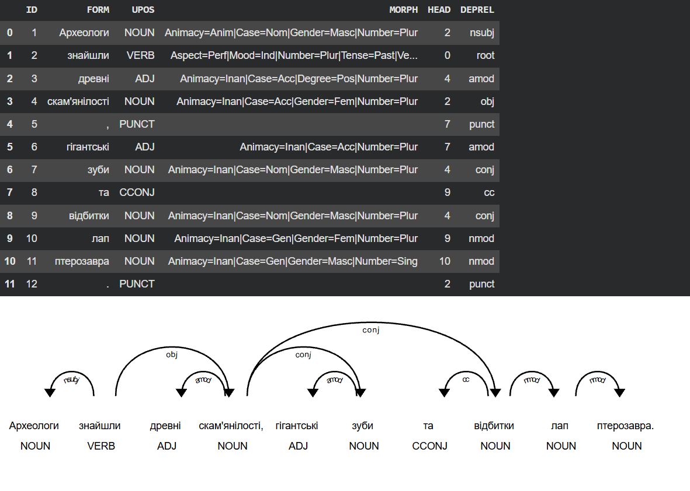
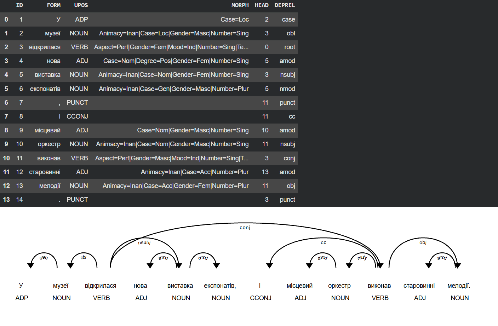
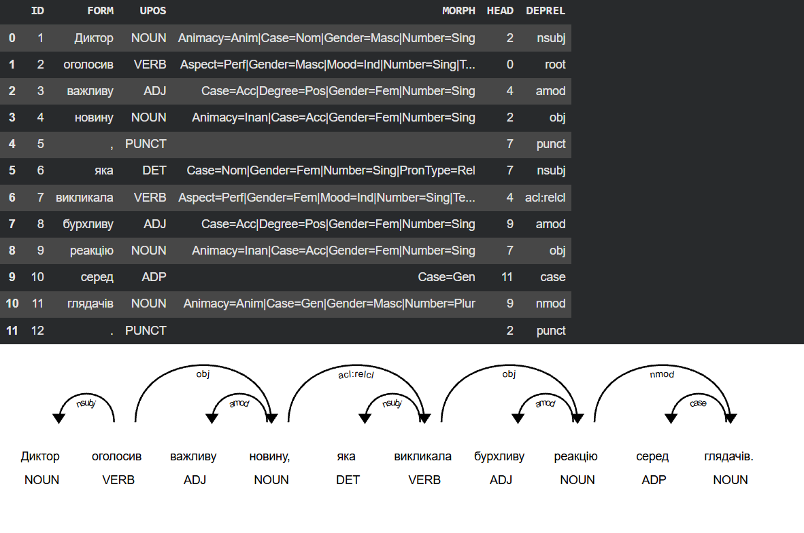
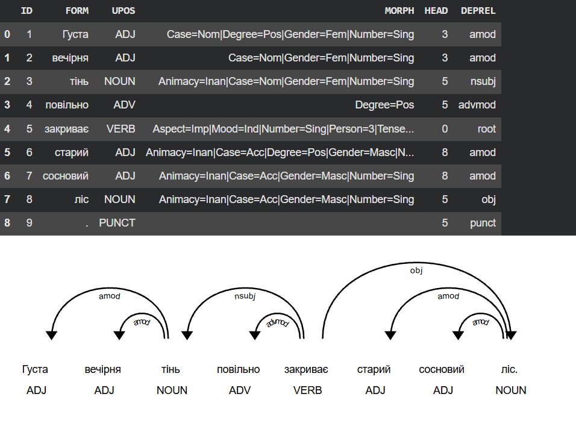
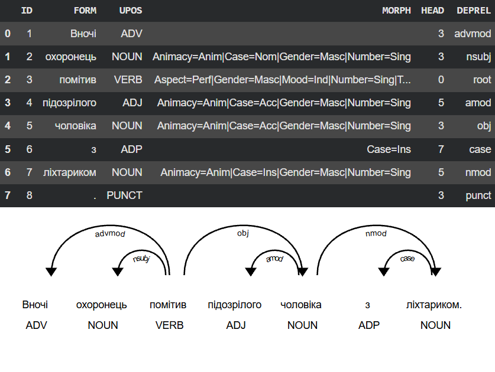

# Звіт до завдання №3

---

# 1. Вибрані речення

Для експерименту було підібрано 7 українських речень: 5 речень різних синтаксичних типів і 2 речення-пастки.

| № | Тип | Речення |
|---:|---|---|
| 1 | Просте | Потужний телескоп зафіксував яскраві спалахи на далекій планеті. |
| 2 | З дієприслівниковим/дієприкметниковим зворотом | Мандрівники, приголомшені красою гірського пейзажу, зупинилися біля джерела. |
| 3 | З однорідними членами | Археологи знайшли древні скам'янілості, гігантські зуби та відбитки лап птерозавра. |
| 4 | Складносурядне | У музеї відкрилася нова виставка експонатів, і місцевий оркестр виконав старовинні мелодії. |
| 5 | Складнопідрядне | Диктор оголосив важливу новину, яка викликала бурхливу реакцію серед глядачів. |
| 6 | Пастка: омонімія відмінків | Густа вечірня тінь повільно закриває старий сосновий ліс. |
| 7 | Пастка: неоднозначна прийменникова група | Вночі охоронець помітив підозрілого чоловіка з ліхтариком. |

## 1.1. Обґрунтування вибору речень-пасток

### Речення 6

> Густа вечірня тінь повільно закриває старий сосновий ліс.

У цьому реченні іменники **«тінь»** та **«ліс»** мають однакову форму в називному та знахідному відмінках (омонімія). Синтаксичну роль тут визначає семантика та порядок слів. Це речення дозволяє перевірити, чи не переплутає парсер підмет (`nsubj`) із прямим додатком (`obj`).

### Речення 7

> Вночі охоронець помітив підозрілого чоловіка з ліхтариком.

У цьому реченні прийменникова група **«з ліхтариком»** може бути синтаксично приєднана двома способами:

1. до дієслова **«помітив»**: охоронець використав ліхтарик, щоб у темряві помітити чоловіка;
2. до іменника **«чоловіка»**: чоловік мав при собі ліхтарик.

Як еталон у цій роботі було спеціально зафіксовано перше прочитання: `ліхтариком → помітив (obl)`. Це дозволяє перевірити, чи зможе парсер відійти від статистичного правила прикріплення прийменників до найближчого іменника і розпізнати ширший контекст.

---

# 2. Еталонна синтаксична розмітка

Еталон було побудовано до порівняння результатів парсерів.  
`HEAD = 0` означає корінь речення.

## 2.1. Речення 1

**Потужний телескоп зафіксував яскраві спалахи на далекій планеті.**

| ID | Слово | HEAD | DEPREL |
|---:|---|---:|---|
| 1 | Потужний | 2 | `amod` |
| 2 | телескоп | 3 | `nsubj` |
| 3 | зафіксував | 0 | `root` |
| 4 | яскраві | 5 | `amod` |
| 5 | спалахи | 3 | `obj` |
| 6 | на | 8 | `case` |
| 7 | далекій | 8 | `amod` |
| 8 | планеті | 3 | `obl` |
| 9 | . | 3 | `punct` |

## 2.2. Речення 2

**Мандрівники, приголомшені красою гірського пейзажу, зупинилися біля джерела.**

| ID | Слово | HEAD | DEPREL |
|---:|---|---:|---|
| 1 | Мандрівники | 8 | `nsubj` |
| 2 | , | 3 | `punct` |
| 3 | приголомшені | 1 | `acl` |
| 4 | красою | 3 | `obl` |
| 5 | гірського | 6 | `amod` |
| 6 | пейзажу | 4 | `nmod` |
| 7 | , | 3 | `punct` |
| 8 | зупинилися | 0 | `root` |
| 9 | біля | 10 | `case` |
| 10 | джерела | 8 | `obl` |
| 11 | . | 8 | `punct` |

## 2.3. Речення 3

**Археологи знайшли древні скам'янілості, гігантські зуби та відбитки лап птерозавра.**

| ID | Слово | HEAD | DEPREL |
|---:|---|---:|---|
| 1 | Археологи | 2 | `nsubj` |
| 2 | знайшли | 0 | `root` |
| 3 | древні | 4 | `amod` |
| 4 | скам'янілості | 2 | `obj` |
| 5 | , | 7 | `punct` |
| 6 | гігантські | 7 | `amod` |
| 7 | зуби | 4 | `conj` |
| 8 | та | 9 | `cc` |
| 9 | відбитки | 4 | `conj` |
| 10 | лап | 9 | `nmod` |
| 11 | птерозавра | 10 | `nmod` |
| 12 | . | 2 | `punct` |

## 2.4. Речення 4

**У музеї відкрилася нова виставка експонатів, і місцевий оркестр виконав старовинні мелодії.**

| ID | Слово | HEAD | DEPREL |
|---:|---|---:|---|
| 1 | У | 2 | `case` |
| 2 | музеї | 3 | `obl` |
| 3 | відкрилася | 0 | `root` |
| 4 | нова | 5 | `amod` |
| 5 | виставка | 3 | `nsubj` |
| 6 | експонатів | 5 | `nmod` |
| 7 | , | 11 | `punct` |
| 8 | і | 11 | `cc` |
| 9 | місцевий | 10 | `amod` |
| 10 | оркестр | 11 | `nsubj` |
| 11 | виконав | 3 | `conj` |
| 12 | старовинні | 13 | `amod` |
| 13 | мелодії | 11 | `obj` |
| 14 | . | 3 | `punct` |

## 2.5. Речення 5

**Диктор оголосив важливу новину, яка викликала бурхливу реакцію серед глядачів.**

| ID | Слово | HEAD | DEPREL |
|---:|---|---:|---|
| 1 | Диктор | 2 | `nsubj` |
| 2 | оголосив | 0 | `root` |
| 3 | важливу | 4 | `amod` |
| 4 | новину | 2 | `obj` |
| 5 | , | 7 | `punct` |
| 6 | яка | 7 | `nsubj` |
| 7 | викликала | 4 | `acl:relcl` |
| 8 | бурхливу | 9 | `amod` |
| 9 | реакцію | 7 | `obj` |
| 10 | серед | 11 | `case` |
| 11 | глядачів | 9 | `nmod` |
| 12 | . | 2 | `punct` |

## 2.6. Речення 6

**Густа вечірня тінь повільно закриває старий сосновий ліс.**

| ID | Слово | HEAD | DEPREL |
|---:|---|---:|---|
| 1 | Густа | 3 | `amod` |
| 2 | вечірня | 3 | `amod` |
| 3 | тінь | 5 | `nsubj` |
| 4 | повільно | 5 | `advmod` |
| 5 | закриває | 0 | `root` |
| 6 | старий | 8 | `amod` |
| 7 | сосновий | 8 | `amod` |
| 8 | ліс | 5 | `obj` |
| 9 | . | 5 | `punct` |

## 2.7. Речення 7

**Вночі охоронець помітив підозрілого чоловіка з ліхтариком.**

| ID | Слово | HEAD | DEPREL |
|---:|---|---:|---|
| 1 | Вночі | 3 | `advmod` |
| 2 | охоронець | 3 | `nsubj` |
| 3 | помітив | 0 | `root` |
| 4 | підозрілого | 5 | `amod` |
| 5 | чоловіка | 3 | `obj` |
| 6 | з | 7 | `case` |
| 7 | ліхтариком | 3 | `obl` |
| 8 | . | 3 | `punct` |

---

## 3. Результати інструментів

Для автоматичного розбору речень було використано два інструменти:
*   **UDPipe 2 (вебсервіс LINDAT):** модель `ukrainian-iu-ud-2.17-251125`.
*   **spaCy (через Python):** версія бібліотеки 3.8.16, модель `uk_core_news_sm` версії 3.8.0.

**Спостереження щодо токенізації та результатів:**
Токенізація в обох інструментах повністю збіглася з еталонною (знаки пунктуації виділено в окремі токени, додаткове вирівнювання не знадобилося).

У ході експерименту було виявлено, що **синтаксичні дерева (визначення вершин HEAD та типів зв'язків DEPREL) у spaCy та UDPipe 2 виявилися абсолютно однаковими для всіх 7 речень**. Обидві моделі ухвалили ідентичні рішення, включно з помилковими. З огляду на повний синтаксичний збіг, щоб уникнути дублювання, нижче для кожного речення наведено таблицю результатів spaCy (яка додатково містить морфологічні теги `MORPH` для аналізу помилок) та загальну візуалізацію побудованого дерева.

---

### 3.1. Речення 1 (Просте)
*Потужний телескоп зафіксував яскраві спалахи на далекій планеті.*



---

### 3.2. Речення 2 (Зі зворотом)
*Мандрівники, приголомшені красою гірського пейзажу, зупинилися біля джерела.*



---

### 3.3. Речення 3 (З однорідними членами)
*Археологи знайшли древні скам'янілості, гігантські зуби та відбитки лап птерозавра.*



---

### 3.4. Речення 4 (Складносурядне)
*У музеї відкрилася нова виставка експонатів, і місцевий оркестр виконав старовинні мелодії.*



---

### 3.5. Речення 5 (Складнопідрядне)
*Диктор оголосив важливу новину, яка викликала бурхливу реакцію серед глядачів.*



---

### 3.6. Речення 6 (Пастка 1: омонімія відмінків)
*Густа вечірня тінь повільно закриває старий сосновий ліс.*



---

### 3.7. Речення 7 (Пастка 2: прийменникова неоднозначність)
*Вночі охоронець помітив підозрілого чоловіка з ліхтариком.*



---

# 4. Метрики UAS і LAS

Оскільки результати обох моделей збіглися абсолютно (усі HEAD і DEPREL ідентичні), зведена таблиця є спільною. Загальна кількість токенів: 75.

| № | Тип речення | Токенів | Правильний HEAD | Правильний HEAD + DEPREL | UAS, % | LAS, % |
|---:|---|---:|---:|---:|---:|---:|
| 1 | Просте | 9 | 9 | 9 | 100.00 | 100.00 |
| 2 | Зі зворотом | 11 | 11 | 10 | 100.00 | 90.90 |
| 3 | З однорідними членами | 12 | 12 | 12 | 100.00 | 100.00 |
| 4 | Складносурядне | 14 | 14 | 14 | 100.00 | 100.00 |
| 5 | Складнопідрядне | 12 | 12 | 12 | 100.00 | 100.00 |
| 6 | Омонімія відмінків | 9 | 9 | 9 | 100.00 | 100.00 |
| 7 | Прийменникова група | 8 | 7 | 7 | 87.50 | 87.50 |

**Загалом (для spaCy та UDPipe 2):**

- правильних HEAD: **74/75**;
- правильних HEAD + DEPREL: **73/75**;
- **UAS = 98.67%**;
- **LAS = 97.33%**.

---

# 5. Експеримент із порядком слів

Для перевірки впливу порядку слів було використано речення:

> Програміст перевіряє нову конфігурацію.

Було створено чотири варіанти:

1. Програміст перевіряє нову конфігурацію. *(Прямий)*
2. Нову конфігурацію перевіряє програміст. *(Зворотний)*
3. Перевіряє програміст нову конфігурацію. *(Дієслово на початку)*
4. Нову конфігурацію програміст перевіряє. *(Дієслово в кінці)*

Усі чотири варіанти були пропущені через модель `uk_core_news_sm` у spaCy.

## 5.1. Варіант 1

**Програміст перевіряє нову конфігурацію.**

| Слово | HEAD | DEPREL |
|---|---|---|
| Програміст | перевіряє | `nsubj` |
| перевіряє | ROOT | `root` |
| нову | конфігурацію | `amod` |
| конфігурацію | перевіряє | `obj` |
| . | перевіряє | `punct` |

Розбір ідеальний.

## 5.2. Варіант 2

**Нову конфігурацію перевіряє програміст.**

| Слово | HEAD | DEPREL |
|---|---|---|
| Нову | конфігурацію | `amod` |
| конфігурацію | перевіряє | `obj` |
| перевіряє | ROOT | `root` |
| програміст | перевіряє | `nsubj` |
| . | перевіряє | `punct` |

Попри зміну порядку слів, синтаксичні ролі збереглися бездоганно.

## 5.3. Варіант 3

**Перевіряє програміст нову конфігурацію.**

| Слово | HEAD | DEPREL |
|---|---|---|
| Перевіряє | ROOT | `root` |
| програміст | Перевіряє | **`obj` (ПОМИЛКА)** |
| нову | конфігурацію | `amod` |
| конфігурацію | Перевіряє | `obj` |
| . | Перевіряє | `punct` |

У цьому варіанті з'явилася груба помилка. Слово «програміст» (підмет у називному відмінку) було позначено як прямий додаток `obj`. Морфологічний модуль при цьому правильно бачив `Case=Nom`.

## 5.4. Варіант 4

**Нову конфігурацію програміст перевіряє.**

| Слово | HEAD | DEPREL |
|---|---|---|
| Нову | конфігурацію | `amod` |
| конфігурацію | перевіряє | `obj` |
| програміст | перевіряє | `nsubj` |
| перевіряє | ROOT | `root` |
| . | перевіряє | `punct` |

Структура знову правильна.

## 5.5. Висновок експерименту

Варіанти 1, 2 і 4 показують, що spaCy здебільшого здатний правильно розпізнавати синтаксичні ролі, спираючись на маркер відмінка (називний чи знахідний).

Однак Варіант 3 чітко демонструє, що синтаксичний парсер також значною мірою залежить від статистичних закономірностей порядку слів. Навіть бачачи правильну морфологічну ознаку `Case=Nom`, парсер присвоїв слову «програміст» зв'язок `obj` лише тому, що воно стояло одразу після дієслова (типова позиція об'єкта).

Отже, модель поєднує **опору на морфологію з сильною залежністю від шаблонів порядку слів**, що може призводити до збоїв у нестандартних конфігураціях.

---

# 6. Аналіз помилок і розбіжностей

| Речення | Слово | Еталон | spaCy | UDPipe | Тип |
|---|---|---|---|---|---|
| Мандрівники, приголомшені... | приголомшені | `HEAD=1`, `acl` | `HEAD=1`, `amod` | `HEAD=1`, `amod` | `LABEL` |
| Вночі охоронець помітив... | ліхтариком | `HEAD=3`, `obl` | `HEAD=5`, `nmod` | `HEAD=5`, `nmod` | `AMBIG` |

1. **Помилка LABEL:** У реченні 2 обидва парсери правильно визначили вершину (`HEAD=1`), але схибили в типі синтаксичного зв'язку (`amod` замість `acl`). При цьому морфологічний аналізатор спрацював коректно згідно зі стандартом Universal Dependencies: слову було призначено тег `UPOS: ADJ` і додано суттєву ознаку дієприкметника `VerbForm=Part`. Помилка сталася саме на етапі синтаксичного парсингу: синтаксичний парсер автоматично застосував стандартний зв'язок `amod`, ігноруючи наявність залежних слів, що утворюють зворот.
2. **Розбіжність AMBIG:** Розбіжність у реченні 7 є класичним прикладом проблеми синтаксичної неоднозначності (PP-attachment). Обидва парсери помилилися і у визначенні вершини (UAS), і у типі зв'язку (LAS), оскільки вони застосували статистичне правило пізнього приєднання (Late Closure) і приєднали прийменникову групу до найближчого іменника («чоловіка» → `nmod`). Вони не змогли зрозуміти ширший контекст, закладений в еталоні, де ліхтарик є інструментом дії («помітив» → `obl`).

---

# 7. Відповіді на питання

## 7.1. У яких типах речень інструменти помиляються найчастіше? Чи збігається це з таблицею точності зв'язків із презентації?

У межах експерименту інструменти припустилися розбіжностей у двох випадках: реченні з дієприкметниковим зворотом (LABEL) та реченні із синтаксичною неоднозначністю прийменникової групи (AMBIG). Це підтверджує, що найчастіше парсери помиляються у складних нефінітних конструкціях та прикріпленнях модифікаторів. Це повністю корелює зі статистикою парсерів (таблицею з презентації), де точність коротких зв'язків (case, amod) сягає 97–98%, а базових членів речення (nsubj, obj) — близько 92–93%. Натомість точність клаузних зв'язків (acl, advcl) суттєво нижча і падає до 75–81% через синтаксичну та морфологічну неоднозначність.

## 7.2. Які помилки синтаксису спричинені помилками морфології? Як це встановлено?

У досліджуваній вибірці прямих помилок синтаксису, які були б спричинені саме збоєм морфологічного аналізатора, **не виявлено**.

Зокрема, у реченні 2 для слова «приголомшені» морфологічний розбір виявився бездоганним: spaCy визначив його як `UPOS: ADJ` з повною морфологічною розміткою `Aspect=Perf|Case=Nom|Number=Plur|VerbForm=Part`. Згідно з настановами Universal Dependencies, дієприкметники позначаються тегом `ADJ`, а їхня дієслівна природа маркується `VerbForm=Part`.

Таким чином, розбіжність між еталонним `acl` та прогнозованим `amod` виникла не через помилку морфології, а **на етапі синтаксичного аналізатора**. Парсер мав повний набір правильних морфологічних маркерів, проте не врахував наявність власної залежної групи у дієприкметника (керованого додатка «красою») і віддав перевагу поверхневому статистичному правилу «ADJ → іменник = amod».

## 7.3. Чи впливає порядок слів на розбір? На що спирається модель — на порядок чи на відмінки?

Так, порядок слів критично впливає на розбір моделі spaCy. В експерименті з непрямим порядком слів (*«Перевіряє програміст нову конфігурацію.»*) парсер зламався: він проігнорував тег називного відмінка (`Case=Nom`) у слова «програміст» і позначив його як прямий додаток (`obj`). Це доводить, що статистична модель спирається переважно на позицію слова в реченні (завчену конфігурацію Subject-Verb-Object), часто ігноруючи власні правильні морфологічні дані (відмінки).

## 7.4. Які розбіжності між інструментами є справжніми помилками, а які — різними конвенціями розмітки?

У синтаксичному аналізі 7 речень **spaCy та UDPipe 2 не розійшлися між собою взагалі** (результат однаковий).
Їхня спільна розбіжність з еталоном у реченні 2 (`amod` замість `acl`) є справжньою помилкою (тип LABEL): парсер проігнорував наявність керованої групи слів та ознаку `VerbForm=Part`, призначивши стандартний прикметниковий зв'язок. А розбіжність у реченні 7 (прив'язка ліхтарика) є проявом `AMBIG` — парсери обрали найвірогідніше статистичне прочитання, тоді як еталон вимагав розпізнавання нестандартного контексту. Різниці через конвенції розмітки (`CONV`) не зафіксовано.

## 7.5. UDPipe 2 навчений на ручній розмітці, spaCy — на автоматичній. Чи видно цю різницю на наших реченнях?

На цій вибірці різниці абсолютно не видно. Обидва парсери ідеально впоралися з базовими типами речень, однаково обійшли пастку з омонімією відмінків, і так само однаково схибили на морфології дієприкметника та синтаксичній неоднозначності. Це свідчить про те, що автоматично розмічений корпус (Ukr-Synth) забезпечує якість парсингу базових структур, що не поступається ручній розмітці трибанку `UD_Ukrainian-IU`.

## 7.6. Який інструмент обрати для новин, а який — для соцмереж? Чому?

**Для новин — spaCy (`uk_core_news_sm`):**
Новинний потік потребує високої швидкості обробки великих обсягів даних. spaCy працює локально, швидко й оптимізований для виробничих пайплайнів. Оскільки новини пишуться нормативною літературною мовою зі стандартним синтаксисом, легка модель дає високу точність без зайвих витрат ресурсів.

**Для соцмереж — UDPipe 2:**
Коментарі містять розмовні конструкції, пропуски слів і нестандартну граматику. UDPipe 2 навчений на вручну розміченому збалансованому корпусі `UD_Ukrainian-IU`, тому краще розпізнає складні й нестандартні синтаксичні зв'язки, ніж модель spaCy, навчена на автоматично згенерованих даних (Ukr-Synth).

---

# 8. Висновки

У роботі було порівняно два інструменти автоматичного синтаксичного аналізу української мови: **spaCy** та **UDPipe 2**.

На вибірці з семи речень обидва інструменти показали високий і повністю однаковий результат:

- **UAS = 98.67%**;
- **LAS = 97.33%**.

Для 5 речень із 7 автоматичні дерева повністю збіглися з еталонними. Інструменти бездоганно впоралися з омонімією відмінків (пастка 1). Перша розбіжність (помилка `LABEL`) виникла в реченні з дієприкметниковим зворотом, де парсери призначили прикметниковий зв'язок `amod` замість клаузального `acl`, проігнорувавши залежну групу слів при дієприкметнику. Друга розбіжність (`AMBIG`) виникла в реченні з неоднозначною прийменниковою групою, де моделі застосували статистичне правило пізнього приєднання, проігнорувавши логіку інструментальної дії, закладену в еталон.

Експеримент із порядком слів засвідчив, що парсери (зокрема spaCy) сильно залежать від позиційної статистики. При винесенні дієслова на перше місце модель неправильно класифікувала підмет у називному відмінку як прямий додаток. Це доводить, що закладені в нейромережу шаблони порядку слів інколи переважають над морфологічними ознаками відмінків.

Загалом експеримент довів високу готовність обох моделей до аналізу стандартних українських структур, проте виявив їхню вразливість до вільного порядку слів та семантичної неоднозначності.

---

# Додаток А. Синтаксичний розбір

Опис: Виконує синтаксичний аналіз українських речень за допомогою UDPipe 2 та spaCy і виводить результати у вигляді таблиць.

```python
import spacy
import requests
import pandas as pd
from IPython.display import display

sentences = [
    "Потужний телескоп зафіксував яскраві спалахи на далекій планеті.",
    "Мандрівники, приголомшені красою гірського пейзажу, зупинилися біля джерела.",
    "Археологи знайшли древні скам'янілості, гігантські зуби та відбитки лап птерозавра.",
    "У музеї відкрилася нова виставка експонатів, і місцевий оркестр виконав старовинні мелодії.",
    "Диктор оголосив важливу новину, яка викликала бурхливу реакцію серед глядачів.",
    "Густа вечірня тінь повільно закриває старий сосновий ліс.",
    "Вночі охоронець помітив підозрілого чоловіка з ліхтариком."
]

print("=== РОЗБІР ЧЕРЕЗ UDPIPE 2 ===")
udpipe_url = "https://lindat.mff.cuni.cz/services/udpipe/api/process"
udpipe_params = {
    "model": "ukrainian-iu",
    "tokenizer": "",
    "tagger": "",
    "parser": ""
}

for idx, text in enumerate(sentences, 1):
    udpipe_params["data"] = text
    response = requests.post(udpipe_url, data=udpipe_params).json()
    
    if idx == 1:
        print(f"Використана модель UDPipe: {response.get('model', 'ukrainian-iu')}\n")
    
    conllu_lines = response['result'].strip().split('\n')
    parsed_data = []
    
    for line in conllu_lines:
        if line.startswith('#') or not line.strip():
            continue
        parts = line.split('\t')
        if len(parts) == 10:
            parsed_data.append({
                "ID": parts[0],
                "FORM": parts[1],
                "UPOS": parts[3],
                "HEAD": parts[6],
                "DEPREL": parts[7]
            })
            
    print(f"Речення {idx}: {text}")
    display(pd.DataFrame(parsed_data))
    print("-" * 50)

print("\n=== РОЗБІР ЧЕРЕЗ SPACY ===")
nlp = spacy.load("uk_core_news_sm")
print(f"Версія spaCy: {spacy.__version__}")
print(f"Версія моделі: {nlp.meta['version']}\n")

for idx, text in enumerate(sentences, 1):
    doc = nlp(text)
    parsed_data = []
    
    for token in doc:
        token_id = token.i + 1
        
        if token.head == token:
            head_id = 0
            deprel = "root"
        else:
            head_id = token.head.i + 1
            deprel = token.dep_
            
        parsed_data.append({
            "ID": token_id,
            "FORM": token.text,
            "UPOS": token.pos_,
            "MORPH": str(token.morph),
            "HEAD": head_id,
            "DEPREL": deprel
        })
        
    print(f"Речення {idx}: {text}")
    display(pd.DataFrame(parsed_data))
```

---

# Додаток Б. Оцінка точності (UAS / LAS)

Опис: Порівнює точність розбору моделей UDPipe 2 та spaCy із золотим стандартом за метриками UAS і LAS.

```python
import spacy
import requests
import pandas as pd
from IPython.display import display

sentences = [
    "Потужний телескоп зафіксував яскраві спалахи на далекій планеті.",
    "Мандрівники, приголомшені красою гірського пейзажу, зупинилися біля джерела.",
    "Археологи знайшли древні скам'янілості, гігантські зуби та відбитки лап птерозавра.",
    "У музеї відкрилася нова виставка експонатів, і місцевий оркестр виконав старовинні мелодії.",
    "Диктор оголосив важливу новину, яка викликала бурхливу реакцію серед глядачів.",
    "Густа вечірня тінь повільно закриває старий сосновий ліс.",
    "Вночі охоронець помітив підозрілого чоловіка з ліхтариком."
]

sentence_types = [
    "Просте (Космос)",
    "Зі зворотом (Подорож)",
    "З однорідними (Динозаври)",
    "Складносурядне (Культура)",
    "Складнопідрядне (Новини)",
    "Пастка 1 (форми відмінків)",
    "Пастка 2 (прийменникова група)"
]

gold_standard = [
    [(2, 'amod'), (3, 'nsubj'), (0, 'root'), (5, 'amod'), (3, 'obj'), (8, 'case'), (8, 'amod'), (3, 'obl'), (3, 'punct')],
    [(8, 'nsubj'), (3, 'punct'), (1, 'acl'), (3, 'obl'), (6, 'amod'), (4, 'nmod'), (3, 'punct'), (0, 'root'), (10, 'case'), (8, 'obl'), (8, 'punct')],
    [(2, 'nsubj'), (0, 'root'), (4, 'amod'), (2, 'obj'), (7, 'punct'), (7, 'amod'), (4, 'conj'), (9, 'cc'), (4, 'conj'), (9, 'nmod'), (10, 'nmod'), (2, 'punct')],
    [(2, 'case'), (3, 'obl'), (0, 'root'), (5, 'amod'), (3, 'nsubj'), (5, 'nmod'), (11, 'punct'), (11, 'cc'), (10, 'amod'), (11, 'nsubj'), (3, 'conj'), (13, 'amod'), (11, 'obj'), (3, 'punct')],
    [(2, 'nsubj'), (0, 'root'), (4, 'amod'), (2, 'obj'), (7, 'punct'), (7, 'nsubj'), (4, 'acl:relcl'), (9, 'amod'), (7, 'obj'), (11, 'case'), (9, 'nmod'), (2, 'punct')],
    [(3, 'amod'), (3, 'amod'), (5, 'nsubj'), (5, 'advmod'), (0, 'root'), (8, 'amod'), (8, 'amod'), (5, 'obj'), (5, 'punct')],
    [(3, 'advmod'), (3, 'nsubj'), (0, 'root'), (5, 'amod'), (3, 'obj'), (7, 'case'), (3, 'obl'), (3, 'punct')]
]

nlp = spacy.load("uk_core_news_sm")
udpipe_url = "https://lindat.mff.cuni.cz/services/udpipe/api/process"

total_tokens = 0
total_uas_sp, total_las_sp = 0, 0
total_uas_ud, total_las_ud = 0, 0

table_rows = []

for i, text in enumerate(sentences):
    gold = gold_standard[i]
    num_tokens = len(gold)
    total_tokens += num_tokens
    
    udpipe_response = requests.post(udpipe_url, data={
        "model": "ukrainian-iu", "tokenizer": "", "tagger": "", "parser": "", "data": text
    }).json()
    
    conllu_lines = [line.split('\t') for line in udpipe_response['result'].strip().split('\n') if not line.startswith('#') and line.strip()]
    udpipe_preds = [(int(parts[6]), parts[7]) for parts in conllu_lines if len(parts) == 10]
    
    doc = nlp(text)
    spacy_preds = []
    for token in doc:
        head_id = 0 if token.head == token else token.head.i + 1
        deprel = "root" if token.head == token else token.dep_
        spacy_preds.append((head_id, deprel))
        
    uas_ud, las_ud, uas_sp, las_sp = 0, 0, 0, 0
    
    for j in range(num_tokens):
        g_head, g_dep = gold[j]
        
        u_head, u_dep = udpipe_preds[j]
        if u_head == g_head:
            uas_ud += 1
            if u_dep == g_dep:
                las_ud += 1
                
        s_head, s_dep = spacy_preds[j]
        if s_head == g_head:
            uas_sp += 1
            if s_dep == g_dep:
                las_sp += 1
                
    total_uas_ud += uas_ud
    total_las_ud += las_ud
    total_uas_sp += uas_sp
    total_las_sp += las_sp
    
    table_rows.append({
        "№": i + 1,
        "Тип речення": sentence_types[i],
        "Токенів": num_tokens,
        "UDPipe: UAS": f"{uas_ud}/{num_tokens} ({uas_ud/num_tokens:.0%})",
        "UDPipe: LAS": f"{las_ud}/{num_tokens} ({las_ud/num_tokens:.0%})",
        "spaCy: UAS": f"{uas_sp}/{num_tokens} ({uas_sp/num_tokens:.0%})",
        "spaCy: LAS": f"{las_sp}/{num_tokens} ({las_sp/num_tokens:.0%})"
    })

table_rows.append({
    "№": "Разом",
    "Тип речення": "Усі речення",
    "Токенів": total_tokens,
    "UDPipe: UAS": f"{total_uas_ud}/{total_tokens} ({total_uas_ud/total_tokens:.2%})",
    "UDPipe: LAS": f"{total_las_ud}/{total_tokens} ({total_las_ud/total_tokens:.2%})",
    "spaCy: UAS": f"{total_uas_sp}/{total_tokens} ({total_uas_sp/total_tokens:.2%})",
    "spaCy: LAS": f"{total_las_sp}/{total_tokens} ({total_las_sp/total_tokens:.2%})"
})

df_metrics = pd.DataFrame(table_rows)
display(df_metrics)
```

---

# Додаток В. Аналіз порядку слів

Опис: Досліджує вплив зміни порядку слів у реченні на результат синтаксичного розбору в spaCy.

```python
import spacy
import pandas as pd
from IPython.display import display

nlp = spacy.load("uk_core_news_sm")

variants = [
    "Програміст перевіряє нову конфігурацію.",
    "Нову конфігурацію перевіряє програміст.",
    "Перевіряє програміст нову конфігурацію.",
    "Нову конфігурацію програміст перевіряє."
]

for idx, text in enumerate(variants, 1):
    doc = nlp(text)
    parsed_data = []
    
    for token in doc:
        parsed_data.append({
            "Слово": token.text,
            "Відмінок": token.morph.get("Case"),
            "Вершина": token.head.text if token.head != token else "ROOT",
            "Зв'язок (Deprel)": token.dep_
        })
        
    print(f"\nВаріант {idx}: {text}")
    display(pd.DataFrame(parsed_data))
```

---

# Посилання

**[🔗 Повна версія звіту з усіма візуалізаціями доступна в моєму GitHub-репозиторії](https://github.com/AntAndriy7/nlps-labs/lab3)**